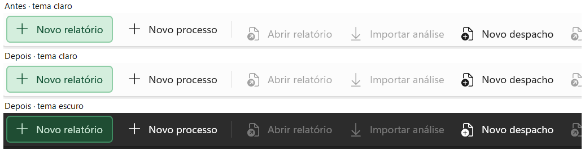

# Verificação final da interface do Editor PMVNI 3.2.3

Base de comparação `d02051d`. Auditoria do aplicativo WinUI 3 em Release x64 no Windows 11. A captura inicial produziu 23 PNGs. Na conferência final, cada tema produziu 35 PNGs, incluindo as dez categorias de Ajustes. Foram inspecionados o enquadramento das janelas e recortes dos controles em resolução nativa. As medidas de layout abaixo estão em DIPs. A janela principal foi capturada em 2378 × 1385 pixels.

Na faixa de Processos, compare a linha de base de “Abrir relatório” e “Novo despacho” com a de “Novo relatório”. Os três recortes abaixo estão na mesma escala.

## Resultado por requisito

| Item | Achado e correção | Alcance da verificação |
|---|---|---|
| 1. Botões | 77 declarações XAML de ações com conteúdo textual receberam ícone de 16 e intervalo de 8. O modelo conserva o conteúdo original para rótulos dinâmicos e acessibilidade. Ações montadas em C# também passaram a usar ícones. Nos grupos de pasta, LibreOffice e reinício, o destaque passou à primeira posição. | Inspeção dos grupos visíveis, teste dos estilos e dos botões textuais XAML. |
| 2. Hover | Na navegação segmentada, a margem de 3 somava-se à borda de 1. A margem interna passou a 2, com raio interno 13 e altura mínima liberada. O envio da IA usa o botão circular tonal do aplicativo. | Geometria conferida no código e em teste. PNGs de captura não registram a transição do mouse. |
| 3. Faixa | Os fundos já mediam 32, mas o conteúdo nativo media 42. Em Relatórios, o ícone do primário começava em Y=54,7 e o dos comandos em Y=60,0. O ajuste passou a centralizar o conteúdo pelo excesso medido, mantendo a borda na posição original. Texto de 12 e ícones de 16, inclusive a reticência. | Medição em execução e inspeção ampliada dos módulos nos dois temas. O teste de alinhamento do roteiro também passou a considerar o centro do botão. |
| 4. Títulos | Estilo de página duplicado em Ajustes, título sem ícone em Novo relatório e Novo despacho e ícone em caixa no Monitor. Títulos passaram a compartilhar estilo, ícone verde de 20 e alinhamento do subtítulo. Removidas exceções locais de tipografia em Modelos e diagnóstico. | Títulos das páginas capturadas conferidos. Monitor conferido no código. |
| 5. Texto e bordas | Cartão compacto com raio 6 e painéis com raio 10 passaram a 8. Campos com reticências explícitas receberam dicas ligadas ao próprio texto. As cinco buscas de página usam lupa de 16, margem de 12 e início do texto em 36. | Capturas de listas, cadastro, propriedades, grupos de botões e pesquisa. O início de uma coluna parcialmente rolada fica oculto pela coluna congelada da planilha. |
| 6. Caixas | Altura mínima de 32 e raio do controle explícitos nos estilos de texto e seleção. O modelo de escolha oferece texto à esquerda, reticências e dica. | Campos simples e caixas de seleção conferidos. Campos com cabeçalho ou várias linhas crescem com o conteúdo. A busca do cabeçalho ocupa os 30 internos de uma pílula de 32. |
| 7. Chaves | A largura do estado escrito podia deslocar a chave. O estilo reserva uma largura mínima comum, e a coluna da auditoria cruzada acomoda o estado por extenso. Corrigida a cor do texto nessa área ao abrir no escuro. | Estados ligado e desligado na página de revisão e três rotas da auditoria cruzada. |
| 8. Menus | Revisados menus declarativos, grupos da faixa e menus contextuais montados em código. Nova regra verifica se os itens de cada menu da faixa usam ícones uniformemente. O menu contextual da planilha separa edição, cópia e exclusão e mostra Enter e Del. | Verificação estrutural. Menus abertos, submenus e todas as combinações de overflow ficam fora dos PNGs. |
| 9. Glifos | Removidos SymbolIcon, entidades XAML, escapes Unicode e caracteres privados embutidos nos consumidores. As janelas de figura e prancha usam o mesmo recorte do catálogo. | Os 98 códigos do catálogo têm mapeamento na Segoe Fluent Icons instalada. Inspeção visual dos glifos expostos nas capturas. |
| 10. Avisos | Os grupos de ações opcionais declarados nas páginas usam AutoOcultar. O novo teste percorre o conteúdo dos InfoBars para evitar regressão. | Comparação entre aviso simples, aviso com ação pendente e confirmação após gravar a cópia da planilha. |
| 11. Comportamento | A inspeção dos handlers de entrada do ponteiro encontrou efeitos visuais. Modelos da análise mostrou a grade na primeira passagem, sem o aviso de kit sem tabela. | Captura da primeira visita e inspeção do fluxo assíncrono. Latência extrema, movimento real do mouse e navegação integral por teclado não foram simulados. |
| 12. Imagens | Marcas claras e escuras do cabeçalho em SVG rasterizado a 320 para 79,2 de altura lógica. O estado vazio conserva a imagem colorida de 128 px enquanto ela comporta a escala e usa o desenho vetorial do módulo acima desse limite, inclusive em mudança de monitor. | Cabeçalho e trilho nos dois temas. A mudança física de monitor/DPI e o limiar acima de 266% foram conferidos apenas no código. |

## Conferência por tela

| Tela | Conferido | Desvio e tratamento | Limite |
|---|---|---|---|
| Cabeçalho e trilho | Marca, navegação, edição, pesquisa, seleção e ícones coloridos | Concentricidade dos segmentos e dicas dos textos abreviados | Hover animado e alto contraste |
| Relatórios | Estado vazio, seções, propriedades de item e ambiente, barra de zoom | Ícones das ações, raio dos painéis, texto abreviado | A superfície WebView2 do documento fica fora da captura XAML |
| Novo relatório | Processo, anexos, pedido, rotas, abertura de ZIP e avisos | Título, ícones e dicas das ações | Execução real de IA reservada para o teste do usuário |
| Monitor da análise | Cabeçalho, atividades, ferramentas e relógios no código | Ícone de título sem fundo e glifos centralizados | Sem execução de análise nesta auditoria |
| Despachos | Estado vazio e comandos de criação | Faixa, ilustração e ícones de ações | Menu de tipos aberto |
| Novo despacho | Origem, documentos, pílula de IA, prévia e rodapé | Título e subtítulo alinhados, ações com ícone | Conferência final e assinatura não aparecem no roteiro de captura |
| Processos | Acervo, filtro, lista, miniaturas e colunas | Raio do cabeçalho, dicas e geometria da faixa | Variação de nomes além das amostras |
| Acompanhamento | Sem fonte, planilha, rolagem, painel, aviso de bloqueio e sucesso | Dicas, ícones e raio do painel | Diálogo de edição em janela separada |
| Imóveis | Filtros, lupa, estado sem QGIS e ações | Estilo do título e glifos das ações | Sem base geográfica configurada na sessão de teste |
| Legislação | Acervo vazio, busca e ações de anexos | Título compartilhado e ações com ícone | Leitor de PDF com documento aberto |
| Essencial e GPI | Faixa e indicador de carregamento | Centralização dos comandos | Navegação autenticada e conteúdo remoto |
| Alfresco | Faixa e aviso de endereço inacessível | Centralização dos comandos | Rede municipal/VPN indisponível no cenário capturado |
| Ajustes · Geral | Abertura, recentes, escolha e chave | Indicador de categoria, ícones e coluna de controle | Diálogo de limpar lista |
| Ajustes · Aparência | Tema claro e escuro, escolhas | Título de categoria comum | Alto contraste |
| Ajustes · Relatórios e revisão | Zoom, densidade, chaves e gravação | Alinhamento de estados com tamanhos diferentes | Todos os valores alternativos das listas |
| Ajustes · Pastas e kit | Pastas, ações e componentes | Ação principal primeiro, atualização com ícone | Instalação e reparo do kit |
| Ajustes · Fontes de dados | QGIS, planilha e sites | Ícones de escolher, abrir, testar e guardar | Autenticação e acesso a fontes de produção |
| Ajustes · Despachos e PDF | LibreOffice, chave e profissional | Ordem Escolher, Testar, Procurar | Seletores externos do Windows |
| Ajustes · Legislação | Escopo e leis anexadas | Ícones e cabeçalho comuns | Anexação por diálogo |
| Ajustes · Inteligência artificial | Cartões, contas, diagnóstico e modelos de IA | Glifo de chave e dicas de textos abreviados | Login e alteração de credenciais |
| Ajustes · Modelos da análise | Primeira visita, grade e auditoria cruzada | Ajuda e contraste por tema, chaves alinhadas | Todas as combinações de rota e falha de rede |
| Ajustes · Sobre e suporte | Versão, atualização e suporte | Tipografia de diagnóstico, ordem e ícones | Instalação de atualização |
| Figuras, prancha, aprovação, impressão e escolha de peças | Inventário do C# e XAML | Catálogo de ícones, ações e raio de painel | O modo de captura não produz PNG individual dessas janelas |

## Reprodução e limites

O build foi executado com `dotnet build -c Release -p:Platform=x64`. A solução reúne sete projetos de teste e o executável auxiliar AgenteFalso. A suíte usou `dotnet test EditorRelatoriosPMVNI.sln -c Release -p:Platform=x64 --no-build` com `PMVNI_TESTES_LIBREOFFICE=1` para incluir as duas conversões reais de teste.

A compilação terminou com **0 erros e 0 avisos**. A execução integral em sequência (`-m:1`) terminou com **1.877 aprovados, 0 falhas e 0 ignorados**. Foram 78 em Composição, 189 em Web, 1.091 em Revisão, 283 em Agentes, 152 em Legislação, 64 em Imóveis e 20 em Acompanhamento. Uma rodada paralela anterior terminou prematuramente no host WebView2 (`0xC0000005` em `DispatchMessage`). A causa dessa interrupção permanece indeterminada.

Cada sessão recebeu seu próprio `PMVNI_DADOS_DIR`. A primeira sessão usou a descoberta padrão de processos do aplicativo. As rodadas ampliadas usaram cópias temporárias de `tests/corpus/processos`, a planilha fictícia do projeto de Acompanhamento, `tests/corpus/longo.json` e um ZIP fictício. A geração de um relatório real ficou reservada para a etapa seguinte. A tabela identifica os estados que o roteiro não abre. A inspeção visual foi feita na escala desta máquina e não certifica tolerância universal de dois pixels em outros monitores.

## Índice da varredura por arquivo

O inventário percorreu 21 arquivos XAML e 153 arquivos C# no estado de entrega, excluindo fontes geradas em bin e obj. A tabela registra os itens para os quais a busca localizou referências textuais. Um traço indica ausência de correspondência. A cobertura visual efetiva está indicada por tela acima.

| Arquivo em src/Pmvni.App | Itens com referências |
|---|---|
| AberturaExterna.cs | — |
| Acompanhamento/DetectorProcesso.cs | — |
| Agentes/CatalogoModelosIa.cs | — |
| Agentes/SessaoNovoRelatorio.cs | — |
| App.xaml | — |
| App.xaml.cs | — |
| AreaTransferencia.cs | — |
| Argumentos.cs | — |
| Atualizador.cs | — |
| Autoteste.cs | — |
| Controles/AcoesDeAviso.cs | 10 |
| Controles/AlcaColuna.cs | 1, 5 |
| Controles/AlcaDeLargura.cs | — |
| Controles/AreaDeAvisos.cs | 1, 5, 10 |
| Controles/AutotesteBrilho.cs | — |
| Controles/Brilho.cs | 1, 2, 3 |
| Controles/BrilhoArcoIris.cs | 1, 5, 10 |
| Controles/CabecalhoMovel.cs | 1 |
| Controles/CartaoAgente.xaml | 1, 4, 5, 6, 9 |
| Controles/CartaoAgente.xaml.cs | 4 |
| Controles/CartoesDePainel.cs | 1, 4, 6, 9 |
| Controles/Dicas.cs | 4, 5 |
| Controles/Elevacao.cs | — |
| Controles/EstadoVazio.xaml | 1, 4, 5, 9 |
| Controles/EstadoVazio.xaml.cs | 1, 3, 4, 5, 9 |
| Controles/EtiquetaSituacao.cs | 1, 4, 5 |
| Controles/FaixaDeOpcoes.xaml | 1, 2, 3, 5, 11 |
| Controles/FaixaDeOpcoes.xaml.cs | 1, 2, 3, 5, 8, 9, 11 |
| Controles/GraficoPizza.cs | — |
| Controles/IconeArquivo.cs | 9, 12 |
| Controles/IconeDeAcao.cs | 1, 9 |
| Controles/IndicadorAvisos.xaml | 1, 4, 5, 8, 9 |
| Controles/IndicadorAvisos.xaml.cs | 1, 5, 8 |
| Controles/LinhaAjuste.cs | 1, 6, 7 |
| Controles/LinhaAndamento.cs | 4, 5, 9 |
| Controles/MenuTexto.cs | 8, 9 |
| Controles/MiniaturaArquivo.cs | 11, 12 |
| Controles/MiniaturasDoShell.cs | — |
| Controles/PainelCartoesAjustes.cs | — |
| Controles/PainelPrancha.cs | 3, 4, 5, 9 |
| Controles/PainelQuebra.cs | — |
| Controles/Pilulas.cs | 1, 3, 5 |
| Controles/SeloEstado.xaml | 5, 9 |
| Controles/SeloEstado.xaml.cs | — |
| Controles/Trilho.xaml | 1, 2, 5 |
| Controles/Trilho.xaml.cs | 1, 2, 3, 5, 8, 12 |
| Despachos/DicasDeBotoesDoDespacho.cs | 1 |
| Despachos/IaAjusteItem.cs | 4 |
| Despachos/IaAjusteTexto.cs | 4 |
| Despachos/IaDespacho.cs | — |
| Despachos/IaRecalculoIndices.cs | 4 |
| Despachos/JanelaAprovacao.cs | 1, 4, 5, 6, 8, 9, 12 |
| Despachos/SessaoNovoDespacho.cs | 12 |
| Dialogos/EscolhaDePecas.xaml | 5 |
| Dialogos/EscolhaDePecas.xaml.cs | 1, 4, 5, 9, 12 |
| Edicao/SessaoEdicao.cs | 11 |
| Estilos.xaml | 1, 2, 3, 4, 5, 6, 7, 9 |
| Figuras/HostFiguras.cs | — |
| Figuras/JanelaFigura.cs | 1, 3, 4, 5, 6, 8, 9, 10, 11, 12 |
| Figuras/JanelaPrancha.cs | 1, 3, 4, 5, 6, 9, 10, 11, 12 |
| Impressao/JanelaImpressao.cs | 1, 4, 5, 8, 9 |
| InstalacaoMotorPdf.cs | — |
| ItemNavegacao.cs | 4, 9 |
| Legislacao/SessaoLegislacao.cs | 4 |
| Logica/AchadosExecucao.cs | 4 |
| Logica/AcompanhamentoPlugins.cs | — |
| Logica/Ajustes.cs | 3 |
| Logica/Atalhos.cs | 8 |
| Logica/Atividades.cs | 4, 9 |
| Logica/AvisosLayout.cs | 3, 10 |
| Logica/Bci.cs | — |
| Logica/CacheDeIcones.cs | — |
| Logica/CaixaEdicaoPrevia.cs | 8 |
| Logica/CategoriasAjustes.cs | 3, 4, 9 |
| Logica/CofreSites.cs | — |
| Logica/ComandosApp.cs | 3 |
| Logica/ComandosImpressao.cs | 3 |
| Logica/ComandosLegislacao.cs | 3 |
| Logica/ComponentesDoKit.cs | — |
| Logica/ConfigSites.cs | — |
| Logica/CoresIcones.cs | 3, 9 |
| Logica/DiarioDaSessao.cs | — |
| Logica/DicasComandos.cs | 3, 4 |
| Logica/EstadoGravacao.cs | 9 |
| Logica/EtiquetasSituacao.cs | — |
| Logica/Faixas.cs | 3, 9 |
| Logica/FechoDaPrevia.cs | — |
| Logica/FiltroNavegacao.cs | 4 |
| Logica/FluxoNovoDespacho.cs | 4 |
| Logica/FluxoNovoRelatorio.cs | 4, 10 |
| Logica/GestoFigura.cs | — |
| Logica/Glifos.cs | 3, 9 |
| Logica/InteracaoFigura.cs | — |
| Logica/ListaLegislacao.cs | 4 |
| Logica/ListasPastas.cs | 4 |
| Logica/MenuFiguras.cs | 4 |
| Logica/ModeloIaAjuste.cs | — |
| Logica/ModelosDaAnalise.cs | 4 |
| Logica/ModelosIa.cs | — |
| Logica/Modulos.cs | 9 |
| Logica/NomesAcessiveis.cs | — |
| Logica/OrganizacaoArquivos.cs | 4 |
| Logica/PesquisaGeral.cs | 3, 4, 9 |
| Logica/PrimeiraAbertura.cs | — |
| Logica/RecortePrancha.cs | — |
| Logica/RegrasAtualizacao.cs | — |
| Logica/RodapeDespacho.cs | — |
| Logica/TextosAgentes.cs | 4 |
| Logica/TextosAssinatura.cs | 4 |
| Logica/TiposArquivo.cs | 9 |
| Logica/TituloJanela.cs | 4 |
| Logica/VinculoBci.cs | — |
| MainWindow.Acompanhamento.cs | 1, 3, 4, 5, 6, 8, 9, 10, 11 |
| MainWindow.Agentes.cs | 1, 10, 11 |
| MainWindow.Ajustes.cs | 1, 3, 4, 5, 6, 7, 9, 10, 11 |
| MainWindow.Aprovacao.cs | 10 |
| MainWindow.Assinatura.cs | 4, 10 |
| MainWindow.Bci.cs | 1, 5, 9, 10 |
| MainWindow.Diagrama.cs | 1, 4, 6, 8, 9, 10 |
| MainWindow.Figuras.cs | 3, 4, 10 |
| MainWindow.Gravacao.cs | 10, 11 |
| MainWindow.HistoricoAnalises.cs | 10, 11 |
| MainWindow.Imoveis.cs | 1, 3, 4, 5, 6, 9, 10, 11 |
| MainWindow.Imprimir.cs | 3, 4, 10 |
| MainWindow.Legislacao.cs | 3, 4, 5, 10, 11 |
| MainWindow.LeituraPadronizada.cs | 1, 3, 4, 5, 6, 8, 9, 10, 11, 12 |
| MainWindow.ListaLeis.cs | 1, 4, 5, 9, 11 |
| MainWindow.ModelosDaAnalise.cs | 1, 4, 5, 6, 7, 10, 11 |
| MainWindow.ModelosIa.cs | 4, 6, 11 |
| MainWindow.Navegacao.cs | — |
| MainWindow.NovoDespacho.cs | 1, 3, 4, 6, 10, 11, 12 |
| MainWindow.NovoRelatorio.cs | 1, 3, 4, 5, 6, 9, 10, 11 |
| MainWindow.Pastas.cs | 1, 3, 4, 10, 11 |
| MainWindow.Pesquisa.cs | — |
| MainWindow.PesquisaGeral.cs | 3, 4, 5, 8, 9, 10, 11 |
| MainWindow.Propriedades.cs | 1, 3, 4, 5, 6, 8, 9, 10 |
| MainWindow.Revisao.cs | 1, 3, 4, 5, 6, 8, 9, 10, 11 |
| MainWindow.Sites.cs | 1, 4, 5, 6, 9 |
| MainWindow.Sobre.cs | 12 |
| MainWindow.xaml | 1, 2, 3, 4, 5, 6, 9, 12 |
| MainWindow.xaml.cs | 1, 3, 4, 5, 8, 9, 10 |
| NotificacoesWindows.cs | 4 |
| Paginas/PaginaAcompanhamento.xaml | 1, 3, 4, 5, 6, 8, 9, 10 |
| Paginas/PaginaAcompanhamento.xaml.cs | — |
| Paginas/PaginaAjustes.Pesquisa.cs | 4 |
| Paginas/PaginaAjustes.xaml | 1, 3, 4, 5, 6, 7, 9, 10, 11 |
| Paginas/PaginaAjustes.xaml.cs | 4, 6, 9, 10, 11 |
| Paginas/PaginaDespachos.xaml | 1, 4, 5, 9, 10 |
| Paginas/PaginaDespachos.xaml.cs | — |
| Paginas/PaginaImoveis.xaml | 1, 3, 4, 5, 6, 9, 10 |
| Paginas/PaginaImoveis.xaml.cs | — |
| Paginas/PaginaLegislacao.Consulta.cs | — |
| Paginas/PaginaLegislacao.xaml | 1, 3, 4, 5, 6, 9, 10 |
| Paginas/PaginaLegislacao.xaml.cs | 3, 4 |
| Paginas/PaginaNovoDespacho.Folhas.cs | 1, 3, 4, 5, 6, 8, 9, 11, 12 |
| Paginas/PaginaNovoDespacho.xaml | 1, 4, 5, 6, 9, 10, 11 |
| Paginas/PaginaNovoDespacho.xaml.cs | 1, 4, 5, 6, 9, 12 |
| Paginas/PaginaNovoRelatorio.xaml | 1, 3, 4, 5, 6, 9, 10 |
| Paginas/PaginaNovoRelatorio.xaml.cs | 1, 3, 4, 5, 8, 9 |
| Paginas/PaginaProcessos.xaml | 1, 4, 5, 6, 8, 9, 10 |
| Paginas/PaginaProcessos.xaml.cs | 1, 4, 8, 9, 11 |
| Paginas/PaginaRelatorios.xaml | 1, 3, 4, 5, 6, 9, 10 |
| Paginas/PaginaRelatorios.xaml.cs | 3, 4 |
| Paginas/PaginaSites.cs | 5, 10, 11 |
| Perguntas.cs | 1, 4, 6, 11 |
| PonteGeminiWeb.cs | 1, 6 |
| Program.cs | — |
| Recursos/CoresTonais.xaml | 1, 2, 3 |
| Recursos/IconesModulos.xaml | 1, 2, 3, 6 |
| RegistroErros.cs | — |
| Roteiro.cs | 1, 3, 4, 6, 8, 10, 11 |
| Sites/AutotesteJanelas.cs | 4 |
| Sites/JanelaPopupSite.cs | — |
| Sites/ScriptsSites.cs | 1 |
